<div align="center">
  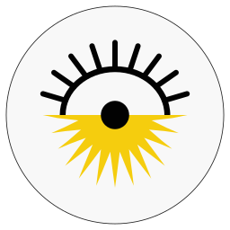

# Roj

**The Kurdish solar calendar for your GNOME desktop.**

ڕۆژ · Roj · *sun* and *day* in Kurdish

[](https://github.com/0xdolan/roj/actions/workflows/ci.yml)
[](https://github.com/0xdolan/roj/releases/latest)
[](#install)
[](LICENSE)

[Website](https://0xdolan.github.io/roj/) · [Live calendar](https://0xdolan.github.io/roj/calendar/) · [Guide](https://0xdolan.github.io/roj/guide.html) · [The name and the logo](docs/STORY.md) · [Releases](https://github.com/0xdolan/roj/releases) · [Changelog](CHANGELOG.md)

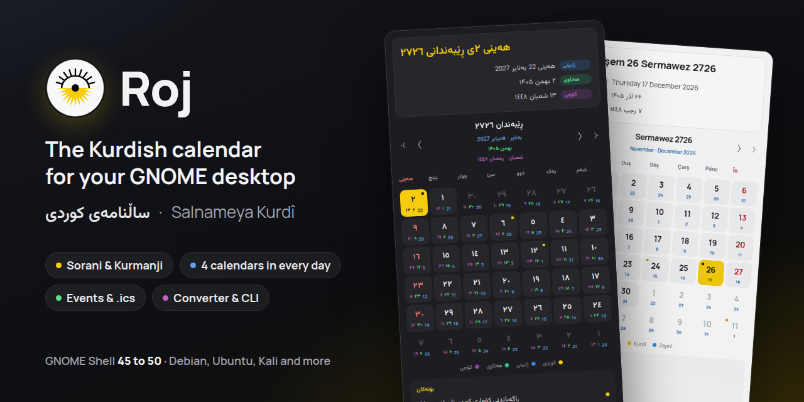
</div>

Roj shows the Kurdish date in the GNOME top bar, and a full calendar when you click it. Every day shows the Kurdish day with the Gregorian, Persian and Islamic days beside it, in Sorani, Kurmanji, English, Persian or Arabic. A `roj` command gives the same answers in a terminal.

The name means both *sun* and *day* in Kurdish, and the logo joins a traditional *deq* tattoo with the sun of the Kurdistan flag. [Read the story and its sources](docs/STORY.md).

## Features

- **Five languages.** Dates and interface in Sorani, Kurmanji, English, Persian or Arabic, laid out right to left where needed. The other calendars can follow your language, the interface, or their own: Gregorian in English, Persian in Persian, Islamic in Arabic.
- **Four calendars in every day.** The Kurdish day is large; the Gregorian (on by default), Persian and Islamic days appear as small numbers of the same size, in a row or in the corners.
- **Written properly.** Sorani ezafe (ی), on for the Kurdish date by default and switchable per calendar. Each calendar keeps the digits of its own language: Persian ۰۱۲, Islamic ٠١٢, Gregorian 012, and the Kurdish date those of your language, unless you choose otherwise. Traditional month names.
- **On the web too.** [The live calendar](https://0xdolan.github.io/roj/calendar/) runs the same engine in any browser: the popup, every Kurdish day with its history, and a converter.
- **Events.** 43 Kurdish days are included, and you can [add them to Google Calendar or an iPhone](#kurdish-events-in-google-calendar-or-on-an-iphone) too. Add your own JSON events or any `.ics` calendar, local or online, with one-click public holidays for Iraq, Iran, Turkey, Syria and Germany. The top bar shows a dot, a count or the title when today has an event.
- **Fonts per script.** Manrope for left-to-right text; Vazirmatn, Estedad or Sahel for Arabic-script text; or any installed font or font file.
- **Your own patterns.** Every strftime token of [tsroj](https://www.npmjs.com/package/@0xdolan/tsroj) and [pyroj](https://pypi.org/project/pyroj/), with presets and live previews.
- **Converter, guide and About pages**, light, dark and system themes, settings export and import, and a popup that keeps the same size on every day.
- **`roj` on the command line**, with a man page, for GJS or Node.js.

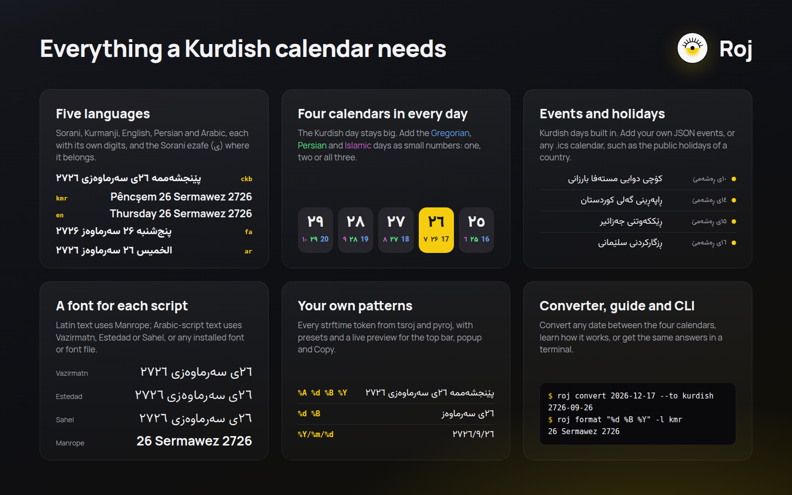

## Screenshots

| Sorani · Kurdistan Flag Day | Kurmanji · Newroz | Persian · own languages |
| --- | --- | --- |
| 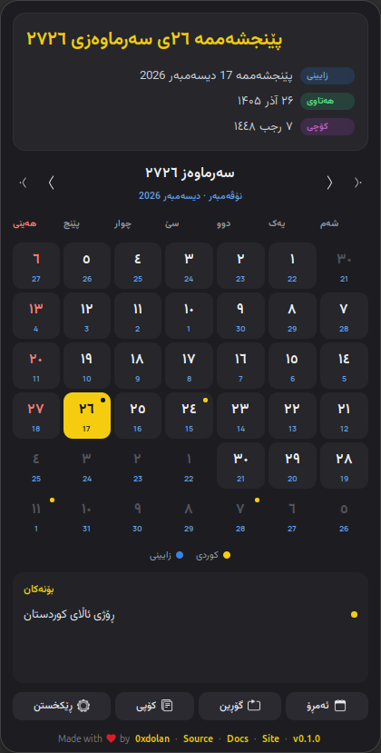 | 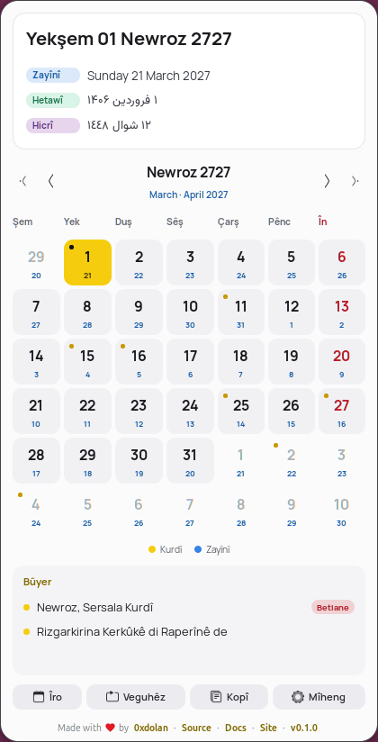 | 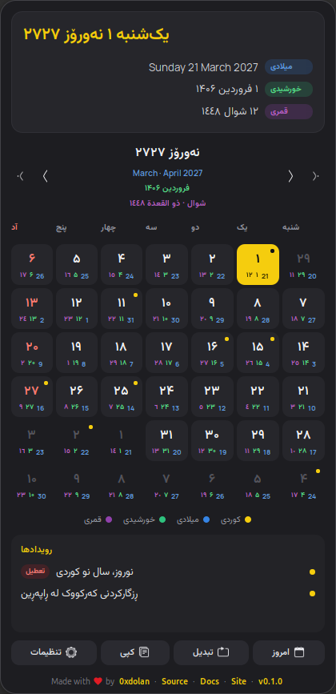 |

| All four calendars | Arabic | English · light |
| --- | --- | --- |
| 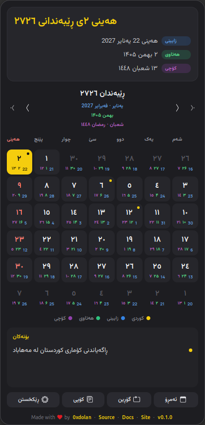 | 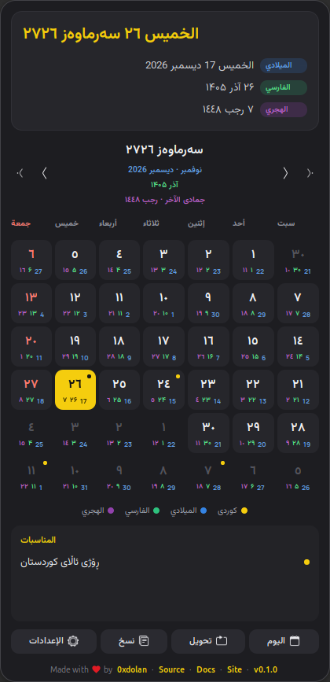 | 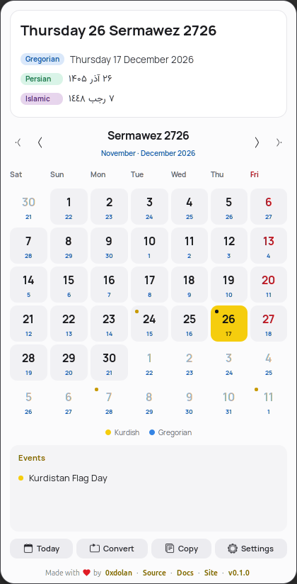 |

| Languages and digits | Appearance | Converter |
| --- | --- | --- |
| 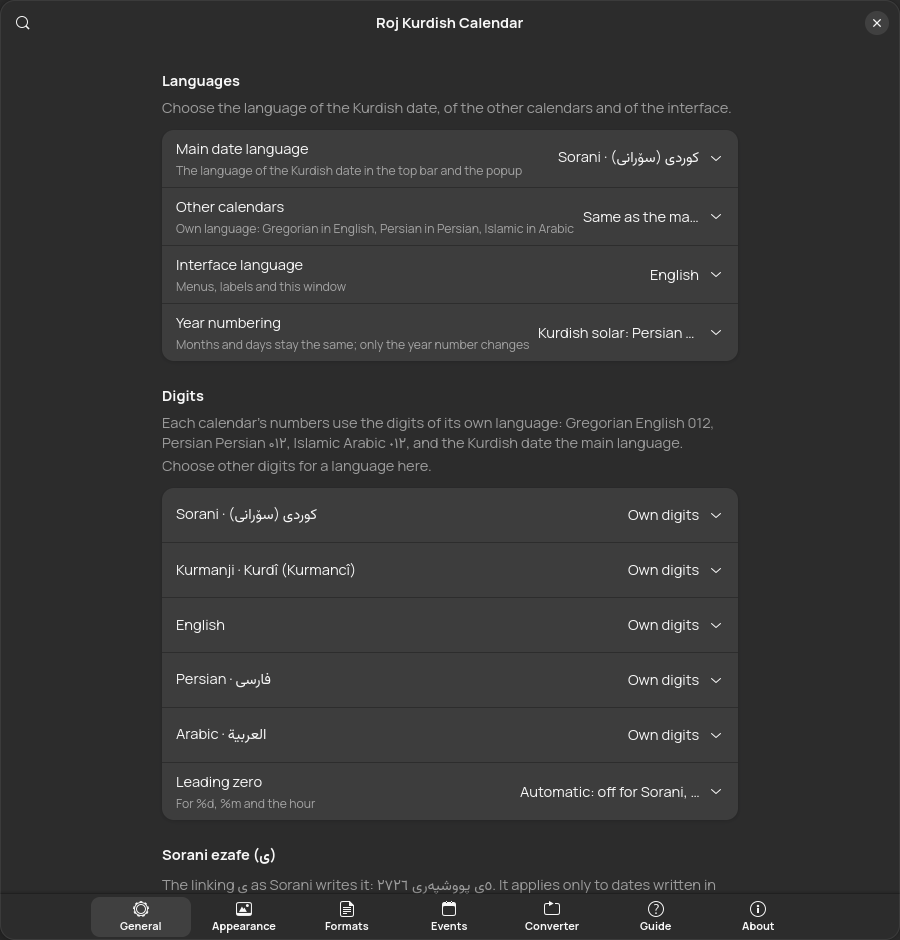 | 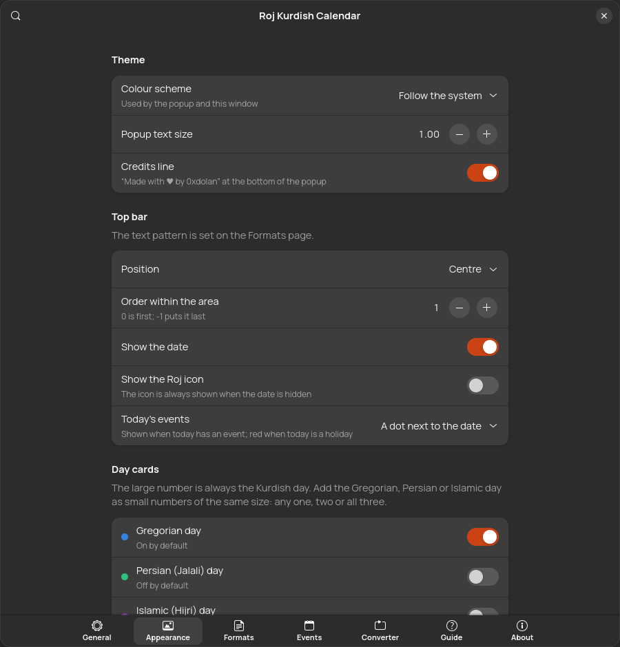 | 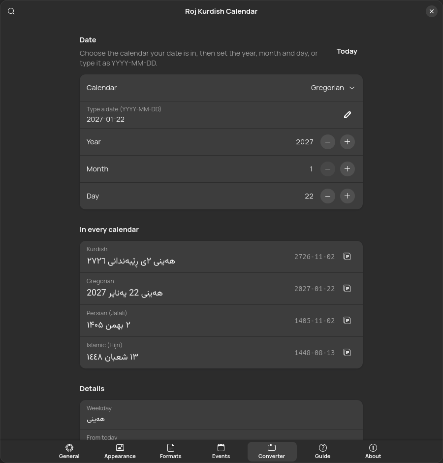 |

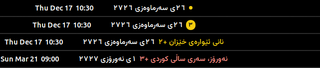

Every screenshot comes from a real GNOME Shell 50 session (`make screenshots`), on three fixed days with Kurdish events: 17 December 2026 (Kurdistan Flag Day), 22 January 2027 (the Republic of Kurdistan) and 21 March 2027 (Newroz).

## Guides

The [guide](https://0xdolan.github.io/roj/guide.html) explains everything with screenshots. Quick recipes:

- [Show the dates in your language](https://0xdolan.github.io/roj/guide.html#howto-language)
- [Show the Persian and Islamic days on every card](https://0xdolan.github.io/roj/guide.html#howto-cards)
- [Add your country's public holidays](https://0xdolan.github.io/roj/guide.html#howto-holidays)
- [Change what the top bar shows](https://0xdolan.github.io/roj/guide.html#howto-topbar)
- [Convert a date](https://0xdolan.github.io/roj/guide.html#howto-convert)
- [Get the Kurdish days on your phone](#kurdish-events-in-google-calendar-or-on-an-iphone)

## Install

The extension needs **GNOME Shell 45 to 50**: Ubuntu 24.04 and newer, Debian 13, Fedora 39 and newer, Kali with GNOME, and most current distributions. Every method below also installs the `roj` command.

| Method | Commands | Updates |
| --- | --- | --- |
| extensions.gnome.org | Search for **Roj** in Extension Manager | Automatic |
| Ubuntu PPA | `sudo add-apt-repository ppa:0xdolan/roj`<br>`sudo apt install gnome-shell-extension-roj roj` | With apt |
| .deb (Debian, Ubuntu, Kali) | Download both from the [latest release](https://github.com/0xdolan/roj/releases/latest), then<br>`sudo apt install ./gnome-shell-extension-roj_*_all.deb ./roj_*_all.deb` | Manual |
| Tarball (any distribution) | `tar xzf roj-*.tar.gz && cd roj-*`<br>`make install` (your user) or `sudo make install-system PREFIX=/usr` | Manual |
| From source | `git clone https://github.com/0xdolan/roj.git && cd roj && make install` | `git pull && make install` |

On Wayland, log out and back in once after installing so GNOME Shell loads Roj. The `roj` command alone needs only GJS or Node.js: the `roj` .deb, or `node extension/cli/roj.js` from a checkout.

## How it works

The Kurdish calendar follows the sun: the year starts at Newroz, the March equinox. Months 1 to 6 have 31 days, months 7 to 11 have 30, and month 12 has 29, or 30 in a leap year; the same lengths as the Persian calendar. Only the year differs: **Kurdish year = Persian year + 1321**, or + 1233 when counting from the fall of Nineveh.

Every date goes through a Julian Day Number, so any calendar converts to any other:

| | 26 June 2026 |
| --- | --- |
| Gregorian | 2026-06-26 |
| Julian Day Number | 2461218 |
| Persian | 1405-04-05 · ۵ تیر ۱۴۰۵ |
| Kurdish | 2726-04-05 · ٥ی پووشپەڕی ٢٧٢٦ · 05 Tîrmeh 2726 |
| Islamic (tabular) | 1448-01-10 · ١٠ محرم ١٤٤٨ |

The engine is [tsroj](https://github.com/0xdolan/tsroj), copied unchanged into [`extension/lib/tsroj.js`](extension/lib/tsroj.js). It was chosen over pyroj because GNOME Shell runs JavaScript: it works inside the shell, with no Python process per redraw and nothing extra to install. The [guide](https://0xdolan.github.io/roj/guide.html) explains every setting, the patterns, fonts, events and the CLI.

## The roj command

```sh
roj                                   # today in all four calendars
roj cal --with g                      # this Kurdish month, with Gregorian days
roj convert 2026-06-26                # Gregorian to every calendar
roj convert 2726-01-01 --from kurdish --to gregorian
roj format "%A %d %B %Y" --locale kmr
roj -l fa --secondary native          # Persian, each calendar in its own language
roj events --month --file holidays.ics
roj ics --locale en > kurdish-events.ics  # events for Google or Apple Calendar
```

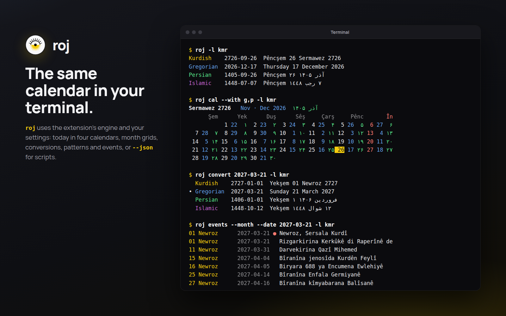

## Events

```json
{
  "name": { "ckb": "بۆنەکانی من", "kmr": "Bûyerên min" },
  "events": [
    { "calendar": "kurdish", "month": 1, "day": 1, "holiday": true,
      "title": { "ckb": "نەورۆز", "kmr": "Newroz", "en": "Newroz" } },
    { "calendar": "gregorian", "year": 2026, "month": 12, "day": 31,
      "time": "20:00", "title": "A one-off event" }
  ]
}
```

`calendar` is `kurdish`, `gregorian`, `persian` or `islamic`; leave out `year` for yearly events. Titles can be `ckb`, `kmr`, `en`, `fa` and `ar`. The included events are in [`extension/data/events/kurdish.json`](extension/data/events/kurdish.json); the full reference is in the [guide](https://0xdolan.github.io/roj/guide.html#events).

## Kurdish events in Google Calendar or on an iPhone

The 43 included Kurdish events are also published as calendars, so you can see them on any phone or computer. The [live calendar page](https://0xdolan.github.io/roj/calendar/) has one-click buttons, the popup itself and every event with its history:

| Language | Subscribe (stays up to date) | Download |
| --- | --- | --- |
| Sorani | `https://0xdolan.github.io/roj/calendar/kurdish-events-ckb.ics` | [kurdish-events-ckb.ics](docs/calendar/kurdish-events-ckb.ics) |
| Kurmanji | `https://0xdolan.github.io/roj/calendar/kurdish-events-kmr.ics` | [kurdish-events-kmr.ics](docs/calendar/kurdish-events-kmr.ics) |
| English | `https://0xdolan.github.io/roj/calendar/kurdish-events-en.ics` | [kurdish-events-en.ics](docs/calendar/kurdish-events-en.ics) |

- **Google Calendar**: on a computer, open [Settings, Add calendar, From URL](https://calendar.google.com/calendar/r/settings/addbyurl), paste a link and choose **Add calendar**. It then shows on your phone too.
- **iPhone and iPad**: open **Settings, Apps, Calendar, Calendar Accounts, Add Account, Other, Add Subscribed Calendar**, paste a link and tap **Next**, then **Save**.
- **Mac**: in Calendar, choose **File, New Calendar Subscription**, paste a link.
- **Import once** instead: download a file, then use Google Calendar's **Settings, Import and export**, or open the file on an iPhone or Mac.

A subscription follows changes to the events; an imported copy does not. Newroz and the two Eids are listed from 2020 to 2060; Eid dates use the arithmetic Hijri calendar and can differ by a day or two from the sighting of the moon. `roj ics` writes the same file, plus any events of your own.

## Development

```sh
make test            # syntax, the no-dash rule, translations and unit tests
make dev-link        # use this checkout as your installed extension (and roj)
make i18n            # untranslated interface messages, per language
make screenshots     # real screenshots from a sandboxed, headless GNOME Shell
make web             # rebuild the website calendar files after editing the engine or events
make marketing       # banner, features, store, themes and terminal images
make release-assets  # zip, tarball, both .deb packages and SHA256SUMS
```

| Path | What it holds |
| --- | --- |
| `extension/lib/` | The GNOME-free core: engine, events, ICS reader, fonts per script, translations |
| `extension/ui/` | The top-bar button and popup (St) |
| `extension/prefs/` | The settings window (GTK 4, libadwaita) |
| `extension/locale/` | Interface translations: Sorani, Kurmanji, Persian, Arabic |
| `extension/cli/roj.js` | The `roj` command |
| `debian/` | Packaging for the `roj` and `gnome-shell-extension-roj` packages |
| `scripts/` | Packaging, releases, screenshots, marketing images and the logo |
| `extension/data/events/` | The included Kurdish events |
| `docs/` | The website, the guide, the story and the Kurdish events calendars (GitHub Pages) |

Please read [CONTRIBUTING.md](CONTRIBUTING.md) first; it includes the project's rules, such as never using em or en dashes.

## Branches and releases

Roj follows git flow. Work happens on `feature/NAME` branches from `develop`, merged by pull request into `develop`. A release goes from `develop` to `main` on a `release/X.Y.Z` branch, also by pull request; `main` is what is released and what the website serves. Both branches are protected: no direct or force pushes, no deletion, and CI must pass. See rule 11 in [CONTRIBUTING.md](CONTRIBUTING.md).

Roj uses [Semantic Versioning](https://semver.org/) and keeps a [changelog](CHANGELOG.md). Once the release pull request is merged, one tag publishes everything:

```sh
git switch main && git pull
git tag -a v0.2.0 -m "Roj 0.2.0" && git push origin v0.2.0
```

The tag builds and publishes everything: the GitHub release with the extension zip, both .deb packages, the source tarball and checksums; the upload to extensions.gnome.org; and the source packages for the Ubuntu PPA. [RELEASING.md](RELEASING.md) has the rules, and [docs/PUBLISHING.md](docs/PUBLISHING.md) the one-time account setup.

## Credits

- Calendar engine: [tsroj](https://github.com/0xdolan/tsroj), also available for Python as [pyroj](https://pypi.org/project/pyroj/).
- Fonts under the SIL Open Font License 1.1: [Manrope](https://github.com/sharanda/manrope), [Vazirmatn](https://github.com/rastikerdar/vazirmatn), [Estedad](https://github.com/aminabedi68/Estedad), [Sahel](https://github.com/rastikerdar/sahel-font).
- Story sources and image credits: [docs/STORY.md](docs/STORY.md).

## License

[GPL-3.0-or-later](LICENSE) © 0xdolan. The fonts keep their own licences ([`extension/fonts/licenses`](extension/fonts/licenses)).
