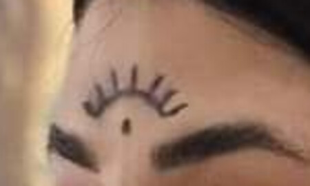
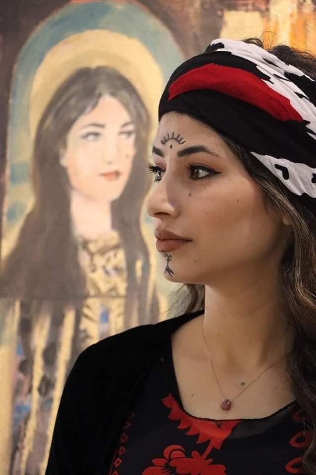

# The name and the logo

## Roj: the sun, and the day

In Kurdish, **roj** (Kurmanji) and **ڕۆژ** (Sorani) mean both **the sun** and **the day**. A solar calendar counts days by the sun, so one Kurdish word names both what the calendar follows and what it counts.

What the sources say:

- **The sun.** The Kurdish Wikipedia article *Roj (stêrk)* opens: "Roj ... stêrka navendî ya Pergala Rojê ye" (Roj is the central star of the Solar System). It adds that the sun "di çanda kurdî de jî xwedî ciheke girîng e ku wekê nîşaneke neteweyî hatiye diyar kirin": in Kurdish culture too it has an important place, and it has been designated a national symbol. [1]
- **The day.** The article *Roj (dem)* defines roj as "yekîneke wext ... ku di bikaranîna rojane de bi bîst û çar saetan re têkildar e", a unit of time associated with twenty-four hours in everyday use. [2]
- **Both, in the dictionary.** Kurdish Wiktionary gives the Kurmanji noun *roj* these senses: the star the earth revolves around, which gives light and heat; the sunshine it gives; the time from morning to evening; and 24 hours, *şevûroj* (night and day). It traces the word to the Proto-Indo-European root *\*lewk-* ("to shine, to give light"), through Proto-Iranian *\*rewç-*. [3]
- **In Sorani.** Wiktionary lists the Sorani noun **ڕۆژ** (plural ڕۆژان, pronounced /roːʒ/) [4], and Sorani Wikipedia describes ڕۆژ as a set period of 24 hours, of night and bright day, caused by the earth turning on its axis. [5]

The same root gives *rojname* (newspaper), *rojane* (daily) and *rojhilat* (east, where the sun rises).

## The logo

The logo joins two Kurdish suns: a *deq* tattoo above, and the sun of the Kurdistan flag below. Together they show a sun rising on the horizon: a new day, a new *roj*.

  
  &nbsp;&nbsp;
  
  &nbsp;&nbsp;
  

### The upper half: the deq

*Deq* are the traditional facial tattoos of Kurdish women. The Kurdish Globe describes them like this: "Known as deq, the tattoos carried both pride and philosophy." The common motifs were "suns, stars, moons, snakes, and peacocks", which "suggest the tattoos once carried sacred significance, linked to nature, fertility, and the cosmos". Marks "could be made between the eyebrows, on the chin, beside the lips, or near the eyes", and their place often matched the wearer's intention: "beauty, fertility, protection, or prosperity". [6]

The design in the logo is worn between the eyebrows: an arc with short rays above a single dot, a sun at the moment it rises. The logo keeps its shape: the arc, nine rays and the dot, drawn in ink black.

Photo: The Kurdish Globe [6].

### The lower half: the sun of the flag

The flag of Kurdistan is "a red, white, and green tricolour, with a yellow 21 rayed sun in the center (Kurdish Sun)", and "the main characteristic of the flag is the blazing golden sun emblem (*Roj* in Kurdish) at its center". Its yellow "represents the source of life and light of the people", and the number of rays, 21, "holds religious and cultural importance in Yazidism, Yarsanism and Alevism" and "symbolizes the rebirth of the Kurdish nation, identity, and dignity". [7]

The logo shows the lower half of that sun, its rays spreading below the horizon line in the same warm yellow.

### Colours

| Use | Colour |
| --- | --- |
| Sun | `#F5CD0E` |
| Ink | `#020202` |
| Face | `#F8F8F8` |

The logo is drawn by [`scripts/make-logo.py`](../scripts/make-logo.py) from measurements of the original tsroj logo, so the SVG and every PNG size stay identical.

## Sources

Accessed on 25 October 2026.

1. *Roj (stêrk)*, Wîkîpediya (Kurmanji Wikipedia). https://ku.wikipedia.org/wiki/Roj_(st%C3%AArk)
2. *Roj (dem)*, Wîkîpediya. https://ku.wikipedia.org/wiki/Roj_(dem) (the article notes that it does not cite sources yet)
3. *roj*, Wîkîferheng (Kurdish Wiktionary). https://ku.wiktionary.org/wiki/roj
4. *ڕۆژ*, Wîkîferheng. https://ku.wiktionary.org/wiki/%DA%95%DB%86%DA%98
5. *ڕۆژ*, ویکیپیدیا (Sorani Wikipedia). https://ckb.wikipedia.org/wiki/%DA%95%DB%86%DA%98 (the article notes that it does not cite sources yet)
6. *Mole Tattoos losing ground in Kurdish society*, The Kurdish Globe, 18 August 2025. https://kurdishglobe.krd/mole-tattoos-losing-ground-in-kurdish-society/
7. *Flag of Kurdistan*, Wikipedia. https://en.wikipedia.org/wiki/Flag_of_Kurdistan

## Image credits

- Deq photo: The Kurdish Globe [6].
- Flag of Kurdistan: [Wikimedia Commons](https://commons.wikimedia.org/wiki/File:Flag_of_Kurdistan.svg), public domain.
- Roj logo: GPL-3.0-or-later, like the rest of Roj.
